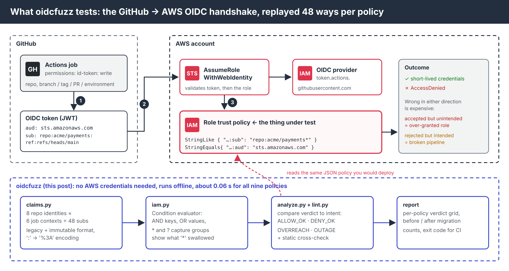
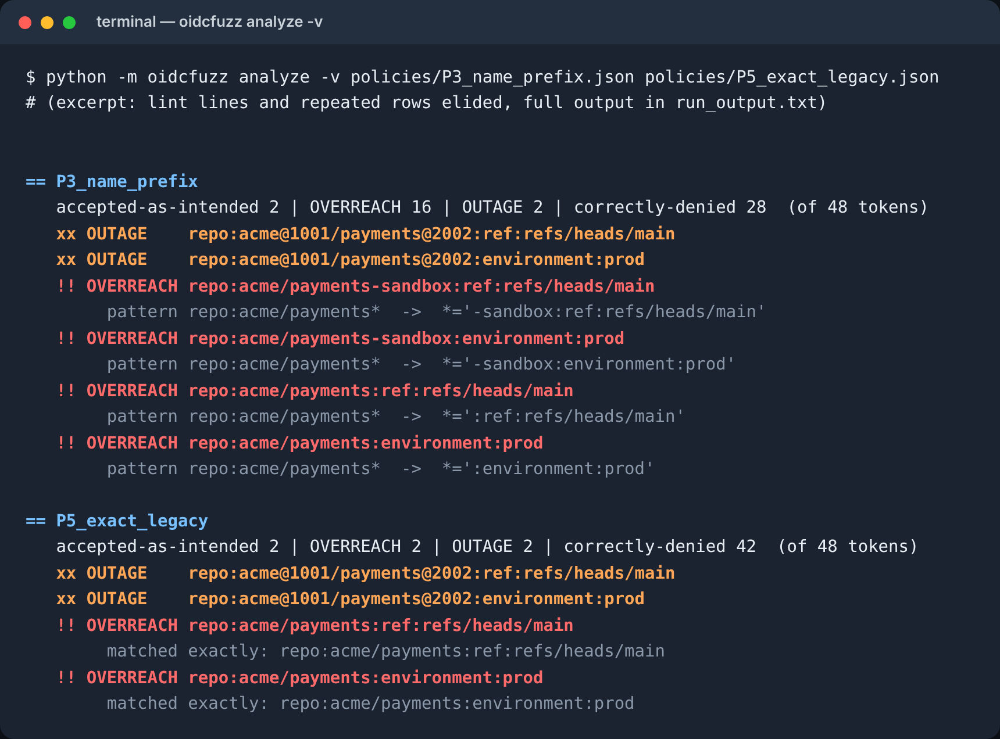
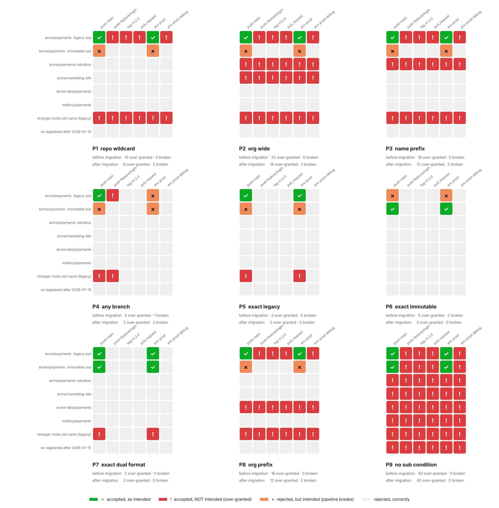
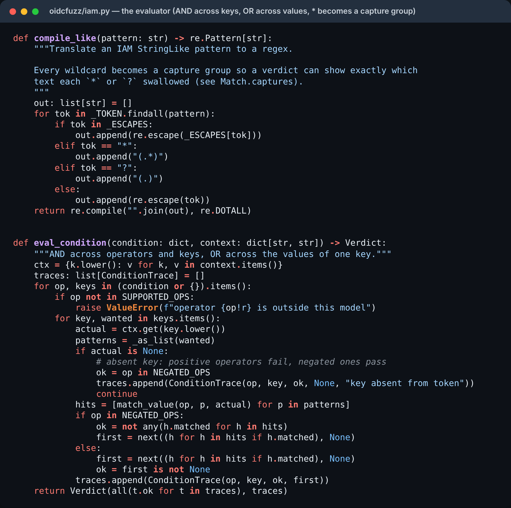
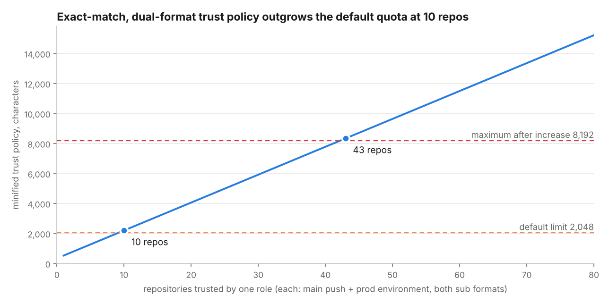

# 🔐 oidcfuzz — Fuzz Your GitHub Actions → AWS OIDC Trust Policies Before Attackers Do

<p align="center">
  
</p>

> **One misplaced wildcard in an IAM trust policy can hand your production AWS role to any repository on GitHub.**
>
> `oidcfuzz` is a pure-Python fuzzer that generates 48 synthetic OIDC `sub` claims — legitimate users, sibling repos, name-squatters, namespace-recyclers — and tests each one against your trust-policy condition block. It tells you *exactly* what a `*` swallowed and whether your pipeline will survive GitHub's upcoming immutable-subject migration.

[](https://www.python.org)
[](tests/)
[](LICENSE)

---

## 🎯 Why This Exists

GitHub Actions OIDC federation with AWS (`aws-actions/configure-aws-credentials`) is the standard way to deploy without long-lived secrets. But the trust policy's `Condition` block is **the entire authorization boundary**, and the patterns people copy from blog posts are almost always wrong:

| Pattern | What goes wrong |
|---------|-----------------|
| `repo:acme/payments*` | Matches `acme/payments-sandbox`, `acme/payments-admin`, any suffixed repo |
| `repo:acme/*` | Every repo in the org gets the role |
| `repo:acme/payments:*` | Any branch, any tag, any PR, any environment |
| `repo:acme/payments:ref:refs/heads/main` (StringEquals) | Breaks the moment the repo renames/transfers (immutable sub) |
| No `sub` condition at all | **Any repository on all of GitHub** can assume the role |

`oidcfuzz` catches every one of these — and the ones you haven't thought of yet.

---

## ⚡ Quickstart

```bash
# Clone & run (zero dependencies beyond Python 3.11+)
git clone https://github.com/Binod231/Fuzzing.git && cd Fuzzing

# Fuzz the included policy gallery
python -m oidcfuzz analyze policies/*.json

# Verbose mode: see exactly what each wildcard swallowed
python -m oidcfuzz analyze -v policies/P3_name_prefix.json
```

<p align="center">
  
</p>

### Fuzz Your Own Policy

```bash
# Point it at your real trust policy (download from AWS console or CLI)
aws iam get-role --role-name GitHubActionsRole \
  --query 'Role.AssumeRolePolicyDocument' > my_policy.json

python -m oidcfuzz analyze -v my_policy.json \
  --org your-org --org-id 12345 --repo your-repo --repo-id 67890
```

Exit codes: `0` = clean, `1` = broken pipeline (outage), `2` = security hole (over-granted).

---

## 🏗️ Architecture

```
 8 identities × 6 contexts = 48 synthetic OIDC tokens
 ─────────────────────────────────────────────────────
 ┌──────────────────┐    ┌──────────────────┐    ┌──────────────────┐
 │  claims.py       │    │  iam.py          │    │  analyze.py      │
 │  Build sub claims│───▶│  Evaluate IAM    │───▶│  Classify each   │
 │  legacy/immutable│    │  conditions      │    │  as ALLOW_OK /   │
 └──────────────────┘    │  (AND/OR/deny)   │    │  OVERREACH /     │
                         └──────────────────┘    │  OUTAGE /        │
 ┌──────────────────┐    ┌──────────────────┐    │  DENY_OK         │
 │  scenarios.py    │    │  lint.py         │    └──────────────────┘
 │  "Only main push │    │  Static pattern  │
 │   & prod env"    │    │  analysis (cross- │
 │  + 6 attackers   │    │  checks fuzzer)  │
 └──────────────────┘    └──────────────────┘
```

### The 8 Identities

| # | Identity | Role | Why it matters |
|---|----------|------|---------------|
| 1 | `acme/payments` (legacy sub) | ✅ Legit | The real repo, pre-migration |
| 2 | `acme/payments` (immutable sub) | ✅ Legit | The same repo after opting into immutable subjects |
| 3 | `acme/payments-sandbox` | ⚠️ Other | Sibling repo — catches `payments*` patterns |
| 4 | `acme/marketing-site` | ⚠️ Other | Different repo in same org — catches `acme/*` |
| 5 | `acme-labs/payments` | 🔴 Attacker | Different org, same repo name — catches `*payments*` |
| 6 | `mallory/payments` | 🔴 Attacker | External actor who forks/names a repo `payments` |
| 7 | Stranger holds `acme/payments` (legacy) | 🔴 Attacker | Namespace recycling: someone registers the freed name |
| 8 | Re-registered `acme/payments` (post-cutoff) | 🔴 Attacker | Same, but after July 2026 — gets immutable sub with *new* IDs |

### The 6 Contexts

`push main` · `push feature/login` · `tag v1.2.0` · `pull_request` · `env prod` · `env prod-debug`

---

## 📊 The Verdict Grid

<p align="center">
  
</p>

Each cell is one (identity, context) pair. **Green ✓** = accepted as intended. **Red !** = accepted but NOT intended (security hole). **Orange ×** = rejected but should have been accepted (broken pipeline). **Grey** = correctly denied.

---

## 🔍 The IAM Evaluator

<p align="center">
  
</p>

The core insight: compile each `StringLike` pattern to a **regex with capture groups**, so the trace can show exactly what `*` swallowed:

```python
def compile_like(pattern: str) -> re.Pattern[str]:
    """Translate an IAM StringLike pattern to a regex.
    Every wildcard becomes a capture group so a verdict can show
    exactly which text each * or ? swallowed."""
    out: list[str] = []
    for tok in _TOKEN.findall(pattern):
        if tok in _ESCAPES:
            out.append(re.escape(_ESCAPES[tok]))
        elif tok == "*":
            out.append("(.*)")
        elif tok == "?":
            out.append("(.)")
        else:
            out.append(re.escape(tok))
    return re.compile("".join(out), re.DOTALL)
```

When the fuzzer reports `OVERREACH`, the trace tells you *why*:

```
!! OVERREACH repo:acme/payments-sandbox:pull_request
     pattern repo:acme/payments*  ->  *='-sandbox:pull_request'
```

The `*` after `payments` swallowed `-sandbox:pull_request` — it crossed the `:` separator and matched a completely different repository.

---

## 📏 Trust Policy Quota Analysis

<p align="center">
  
</p>

AWS trust policies have a **2,048-character default limit** (raisable to 8,192). The dual-format exact-match policy hits the default limit at just **10 repositories**. The `quota` command visualises this:

```bash
python -m oidcfuzz quota
```

---

## 🧪 The Test Suite

```bash
pip install pytest
pytest tests/ -v
```

**37 tests** covering:

- **Differential testing**: the IAM wildcard matcher is tested against an independent recursive reference implementation over 4,000 random inputs
- **Golden counts**: every policy's OVERREACH/OUTAGE counts are pinned to hand-derived values
- **Cross-checking**: the static linter and dynamic fuzzer are verified to agree on wildcard-based vulnerabilities and disagree exactly where expected (namespace recycling — only visible dynamically)
- **Parametric targets**: policies are tested with alternate org/repo identities to verify they aren't accidentally hard-coded

---

## 🛡️ The Policy Gallery

Nine real-world patterns, from copy-paste disasters to hardened best practices:

| Policy | Pattern | Verdict |
|--------|---------|---------|
| **P1** `repo_wildcard` | `repo:acme/payments:*` | ⚠️ Any branch/tag/PR/env |
| **P2** `org_wide` | `repo:acme/*` | 🔴 Every repo in the org |
| **P3** `name_prefix` | `repo:acme/payments*` | 🔴 Crosses `:` into other repos |
| **P4** `any_branch` | `repo:acme/payments:ref:refs/heads/*` | ⚠️ Any branch gets the role |
| **P5** `exact_legacy` | `StringEquals` with legacy subs | ⚠️ Breaks on rename; vulnerable to namespace recycling |
| **P6** `exact_immutable` | `StringEquals` with `@id` subs | ✅ **Only clean policy after migration** |
| **P7** `exact_dual_format` | Both legacy + immutable subs | ✅ No outage, but ⚠️ legacy half is recyclable |
| **P8** `org_prefix` | `repo:acme*/payments:*` | 🔴 Matches `acme-labs` |
| **P9** `no_sub_condition` | No `sub` check at all | 🔴 **Any repo on GitHub** |

---

## 📂 Project Structure

```
oidc-fuzz/
├── oidcfuzz/
│   ├── claims.py        # Build legacy & immutable sub claims
│   ├── scenarios.py     # 8 identities × 6 contexts + intent function
│   ├── iam.py           # IAM condition evaluator (StringEquals/Like/Not*)
│   ├── analyze.py       # Classify each scenario as ALLOW_OK/OVERREACH/OUTAGE/DENY_OK
│   ├── lint.py          # Static pattern analysis (cross-checks the fuzzer)
│   ├── quota.py         # Trust policy length vs AWS quota
│   ├── render.py        # Matplotlib: verdict heatmap + quota chart
│   └── cli.py           # CLI: analyze, quota
├── policies/            # 9 real-world trust policy patterns (JSON)
├── figures/             # Pre-rendered figures for the blog
├── tests/               # 37 tests including differential fuzzing
├── make_figures.py      # Regenerate all figures
├── make_code_images.py  # Render source + terminal as images (Playwright)
└── make_policies.py     # Generate the policy gallery
```

---

## 🤝 Contributing

1. Fork it
2. Add a new policy to `make_policies.py` and re-run `python make_policies.py`
3. Run `pytest tests/ -v` — if a golden count is off, check whether the new policy exposed a real issue
4. Send a PR

---

## 📄 License

MIT — use it, audit your trust policies, stay safe.

---

<p align="center">
  <b>Stop guessing whether your OIDC trust policy is secure. Fuzz it.</b>
  <br>
  <code>python -m oidcfuzz analyze -v your_policy.json</code>
</p>
